# Deep Learning – Homework 2: Two Answers

**Student:** Farah Alhasan  
**Student Number:** 21120205709

**Project title:** Two Answers: Category and Group Labels for Brain, Breast, Skin, and Lung Images

**Repository:** https://github.com/FarahBebs/Deep-Learning-Homework-2

Each uploaded image is scored by two ResNet18 models for that image type.

1. **Specific category.** Brain MRI: glioma, meningioma, pituitary tumor, or no tumor. Breast microscopy:
   one of eight BreakHis tumor subtypes. Skin: one of the seven HAM10000 lesion categories. Lung CT: normal,
   benign, or malignant.
2. **A coarser question, trained as its own model.** Brain: tumor or no tumor. Breast: benign or malignant.
   Skin: cancer-related or not. Lung: malignant or not.

A tumor is not the same thing as cancer. The brain labels do not say benign or malignant, so that model is
not allowed to answer “cancer.” Fibroadenoma, tubular adenoma, adenosis, and the phyllodes folder in BreakHis
are benign. A benign lung slice is not called cancer. On skin, melanoma and basal cell carcinoma are malignant
categories; actinic keratoses are precancerous and still count as cancer-related; nevi and the other three
benign categories do not.

**This is not a medical device.** A score is how strongly a picture matches a training category. It is not a
diagnosis, not a risk estimate, and not something to use for a health decision. A “no tumor” or “normal” label
is a folder name in that dataset, not a clearance that a person is healthy.

LIDC-IDRI is not the lung dataset. It is about 125 GB of 3D CT. The lung module uses IQ-OTH/NCCD slices, which
are labeled normal, benign, or malignant. That is slice classification, not a box drawn around a nodule.

## Project structure

```
cancerai.py            # datasets, ResNet18, training, metrics, Grad-CAM
train.py               # trains both configurations of both tasks and writes results/
app.py                 # Gradio page: upload an image, see the score and a Grad-CAM map
predict_photos.py      # scores photos placed in phone_photos/
examples/              # one held-out public image per class, used by the app
phone_photos/          # where my own photos go (empty apart from labels.csv)
results/               # metrics, curves, confusion matrices, five-case figures
models/                # checkpoints; *_best.pt is the model the app loads
```

`data/` holds the downloaded datasets and the ImageNet ResNet18 weights. It is gitignored because of size
and because HAM10000 is CC BY-NC.

## How to run

The system `python3` on this machine is 3.14 and does not have PyTorch. The project venv uses Python 3.13.

```bash
python3.13 -m venv .venv && source .venv/bin/activate
pip install -r requirements.txt

python train.py                 # brain and skin category models: finetune and frozen
python train.py --task binary   # yes-or-no models for every image type
python train.py --task remaining  # breast and lung, category and yes-or-no
python app.py                   # http://127.0.0.1:7860
python predict_photos.py        # after photos are added under phone_photos/
```

`python train.py --task brain` or `--task skin` trains one category task. `--only frozen` trains only the
frozen-backbone run. The datasets are already downloaded in this folder, so a rerun does not fetch them again.

## Assignment fields

Model choice uses validation macro-F1 only. The test set is scored after that choice, on the restored best
epoch. Both selected models are the fine-tuned ResNet18, epoch 6 of 8.

| Field | Brain MRI | Skin lesion |
|---|---|---|
| Problem / Task | Image classification, 4 classes | Image classification, 7 classes |
| Dataset | Brain Tumor MRI (Nickparvar; figshare, SARTAJ, Br35H), CC BY 4.0 | DermaMNIST 224, from HAM10000, CC BY-NC 4.0 |
| Dataset URL | https://doi.org/10.5281/zenodo.12735702 | https://doi.org/10.7910/DVN/DBW86T |
| Model Architecture | ResNet18, ImageNet weights, all layers fine-tuned, dropout + linear head | same |
| Input Size | 224 × 224 RGB | 224 × 224 RGB |
| Hyperparameters | batch 32, lr 1e-4, weight decay 1e-4, dropout 0.3, up to 8 epochs, patience 3, seed 42 | same |
| Optimizer | AdamW, cosine decay to 1e-6 | same |
| Activation / Output | ReLU in the backbone. Linear logits. Softmax is used only to print scores | same |
| Loss Function | Class-weighted cross-entropy (weights average to 1) | same |
| Evaluation Metrics | Accuracy, macro and weighted precision / recall / F1, confusion matrix, macro one-vs-rest ROC-AUC | same |
| Training Environment | Python 3.13.2, PyTorch 2.15.0, torchvision 0.29.2, Apple Silicon (Mac14,10), 16 GB, MPS | same |
| Best Performance | Test accuracy 99.08%, macro F1 99.03%, macro ROC-AUC 99.97% | Test accuracy 79.40%, macro F1 70.78%, macro ROC-AUC 96.38% |
| Inference Time | 3.8 ms per image (1.2 ms in a batch of 32) | 4.1 ms per image (1.2 ms in a batch of 32) |
| Training Time | 5 min 59 s | 7 min 29 s |
| Deployment Technology | Gradio | Gradio |

The yes-or-no models use the same images, the same splits, and the fine-tune recipe. Only the labels change.
They were not compared against a frozen backbone, because that comparison was already decided on the category
models: fine-tuning won on both image types.

| Field | Brain: tumor or no tumor | Skin: cancer-related or not |
|---|---|---|
| Problem / Task | Binary image classification | Binary image classification |
| How the label is built | Glioma, meningioma, and pituitary tumor become “Tumor detected.” The no-tumor folder stays “No tumor detected.” | Melanoma, basal cell carcinoma, and actinic keratoses / intraepithelial carcinoma become “Cancer-related.” The four benign categories become “Not cancer-related.” |
| Model Architecture | ResNet18, ImageNet weights, all layers fine-tuned | same |
| Input Size | 224 × 224 RGB | 224 × 224 RGB |
| Hyperparameters | batch 32, lr 1e-4, weight decay 1e-4, dropout 0.3, up to 8 epochs, patience 3, seed 42 | same |
| Optimizer | AdamW, cosine decay to 1e-6 | same |
| Loss Function | Class-weighted cross-entropy | same |
| Best epoch | 5 of 8 | 6 of 8 |
| Best Performance | Test accuracy 99.69%, macro F1 99.64%, ROC-AUC 99.95% | Test accuracy 89.78%, macro F1 84.74%, ROC-AUC 94.65% |
| Inference Time | 3.1 ms per image (1.2 ms in a batch of 32) | 3.0 ms per image (1.2 ms in a batch of 32) |
| Training Time | 5 min 22 s | 6 min 34 s |

| Field | Breast: eight subtypes | Breast: benign or malignant | Lung CT: three labels | Lung CT: malignant or not |
|---|---|---|---|---|
| Dataset | BreakHis, 7,909 slides, 82 patients | same images, folders collapsed | IQ-OTH/NCCD, 1,097 CT slices | same slices, normal and benign collapsed |
| Split | Patient-level, seed 42. 54 / 14 / 14 patients | same patients | Image-level 70/15/15. No patient id in the file names | same images |
| Best epoch | 5 of 8 | 6 of 8 | 6 of 8 | 3 of 6 (early stop) |
| Best Performance | Test accuracy 60.31%, macro F1 54.33%, ROC-AUC 85.31%. Validation macro-F1 was only 27.40% | Test accuracy 91.80%, macro F1 91.65%, ROC-AUC 96.99% | Test accuracy 96.36%, macro F1 93.78%, ROC-AUC 99.46% | Test accuracy 99.39%, macro F1 99.39%, ROC-AUC 100.00% |
| Inference Time | 2.9 ms (1.4 ms batched) | 2.8 ms (1.3 ms batched) | 2.8 ms (1.2 ms batched) | 2.9 ms (1.2 ms batched) |
| Training Time | 10 min 49 s | 10 min 50 s | 63 s | 47 s |

The lung scores are not comparable to the breast scores. Breast keeps every slide from one patient in one
split. The lung file names have no patient id, so slices from one scan can sit in both training and test, and
a score near 99% can be optimistic. Benign lung F1 is estimated on 18 test slices.

IoU, mIoU, Dice, and mAP are the right metrics for detection and segmentation. This homework is classification,
so they are not reported. The numbers above are the forward pass. The Gradio call also draws Grad-CAM, so the
time shown in the page is longer (about 0.1–0.7 s on this machine, including the first-call warmup).

## Dataset and the train / validation / test split

### Brain MRI

| Split | Images | Glioma | Meningioma | Pituitary | No tumor | Where it came from |
|---|---:|---:|---:|---:|---:|---|
| Train | 4,855 | 1,123 | 1,138 | 1,238 | 1,356 | 85% of the official Training folder, stratified, seed 42 |
| Validation | 857 | 198 | 201 | 219 | 239 | the other 15% of Training |
| Test | 1,311 | 300 | 306 | 300 | 405 | the official Testing folder, never used for training or model choice |

The four classes are close in size, so accuracy and macro-F1 tell almost the same story. There are no patient
IDs. Several slices can come from one scan, and those slices can land in both Training and Testing. A score
near 99% can be optimistic for a new patient. The publisher of this collection has also said that some glioma
labels inherited from the source folders were wrong and were partly cleaned. I did not re-label anything.

### Skin (DermaMNIST / HAM10000)

I kept the official MedMNIST split. I did not reshuffle it.

| Split | Images | akiec | bcc | bkl | df | mel | nv | vasc |
|---|---:|---:|---:|---:|---:|---:|---:|---:|
| Train | 7,007 | 228 | 359 | 769 | 80 | 779 | 4,693 | 99 |
| Validation | 1,003 | 33 | 52 | 110 | 12 | 111 | 671 | 14 |
| Test | 2,005 | 66 | 103 | 220 | 23 | 223 | 1,341 | 29 |

Short names: akiec = actinic keratoses and intraepithelial carcinoma, bcc = basal cell carcinoma,
bkl = benign keratosis-like lesions, df = dermatofibroma, mel = melanoma, nv = melanocytic nevi,
vasc = vascular lesions.

Nevi are 1,341 / 2,005 = 66.9% of the test set. A model that always says “nevus” would already have 66.9%
accuracy and zero recall on the other six classes. Accuracy is the wrong headline. Macro-F1 gives each class
the same weight, which is why model selection uses validation macro-F1.

HAM10000 can contain more than one image of the same lesion. MedMNIST does not document a lesion-level split,
so I do not claim the test lesions are unseen people. Dermatofibroma has 12 validation and 23 test images, and
vascular lesions have 14 and 29. An F1 on those classes moves if a few images flip.

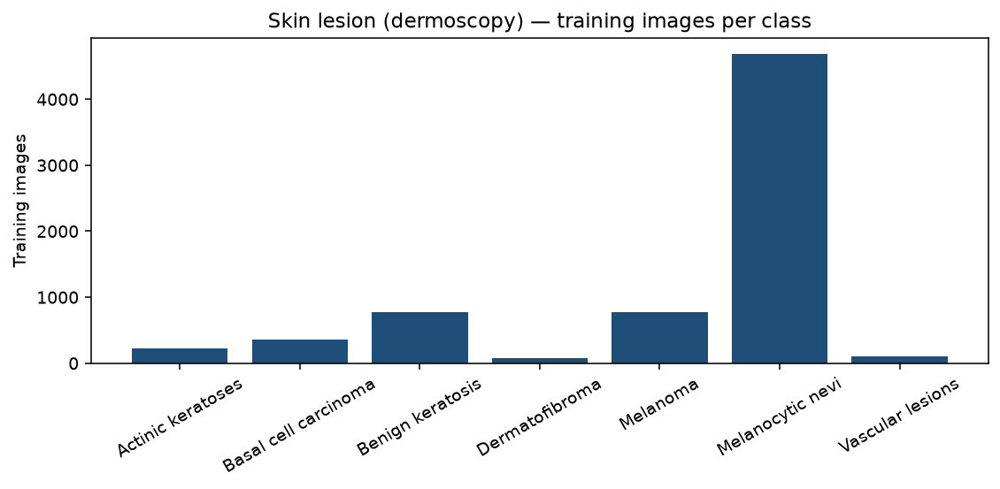

## Why these settings

ResNet18 is deep enough to use ImageNet features and small enough to fine-tune on a 16 GB laptop. The new head
is dropout (0.3) then a linear layer with one logit per class. Cross-entropy applies log-softmax itself, so the
network does not end in a softmax.

I trained two configurations per task and kept the one with the higher validation macro-F1.

| Configuration | What is trained | Learning rate | Epoch cap |
|---|---|---:|---:|
| Finetune | all 11.2 million weights | 1e-4 | 8 |
| Frozen | only the new head (2,052 brain / 3,591 skin) | 1e-3 | 6 |

AdamW with weight decay 1e-4, batch size 32, and cosine decay down to 1e-6. Early stopping watches validation
macro-F1 with patience 3 and a minimum improvement of 0.001, then restores the best epoch before the test
evaluation. Seed is 42.

The loss is class-weighted cross-entropy. Each weight is \(N / (K \cdot n_c)\), then the weights are rescaled
so they average to 1. On the brain set the classes are balanced and the weights stay near 1. On the skin set
the nevus weight falls to about 0.05, while dermatofibroma is about 2.69 and vascular lesions about 2.17.
That stops the loss from being satisfied by calling everything a nevus. It also pushes the model to over-call
the rare classes, which shows up later as low melanoma precision.

Training augmentation, train split only: resize to 256, random resized crop to 224 (scale 0.85–1), horizontal
flip, rotation ±15°, and mild color jitter. Evaluation resizes the whole image to exactly 224×224 and applies
ImageNet mean and standard deviation. A crop at test time would throw away the border of an MRI, so I did not
use one. For the frozen run, batch-norm stays in eval mode so the ImageNet running statistics are not updated
by a small medical batch. Dropout in the head still trains.

Grad-CAM reads the last residual block (`layer4`). The overlay is a picture of which spatial features affected
the winning logit. It is not a tumor outline and not evidence that the class is correct.

## Results

### Which configuration won

| Run | Best epoch | Val macro-F1 | Test accuracy | Test macro-F1 | Test ROC-AUC | Train time |
|---|---:|---:|---:|---:|---:|---:|
| Brain, finetune | 6 of 8 | 98.69% | **99.08%** | **99.03%** | 99.97% | 359.5 s |
| Brain, frozen | 4 of 6 | 87.84% | 82.91% | 82.18% | 95.31% | 179.2 s |
| Skin, finetune | 6 of 8 | 71.66% | **79.40%** | **70.78%** | 96.38% | 448.6 s |
| Skin, frozen | 2 of 5 | 34.43% | 59.75% | 34.57% | 85.83% | 141.6 s |

Fine-tuning is the selected model for both tasks. On brain MRI the frozen ImageNet features already reach the
low 80s, and fine-tuning adds about 16 accuracy points. On dermoscopy the frozen head is not usable: 59.8%
accuracy is below the 66.9% majority baseline, and macro-F1 is 34.6%. Skin images do not look like ImageNet
photographs, so the backbone has to move.

The frozen brain checkpoint is epoch 4 even though epoch 6 reached validation macro-F1 0.879 against 0.878.
The difference is under the 0.001 minimum, so the earlier weights stayed. The frozen skin run stopped at epoch 5
because epochs 3–5 never beat epoch 2.

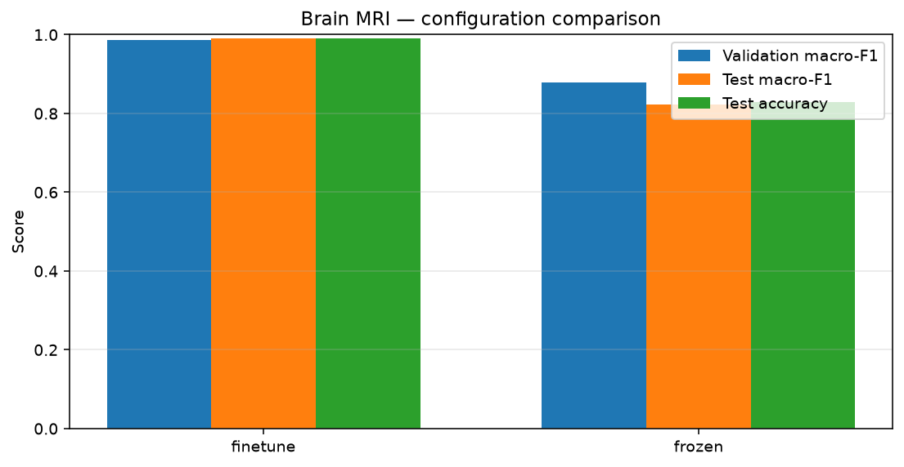

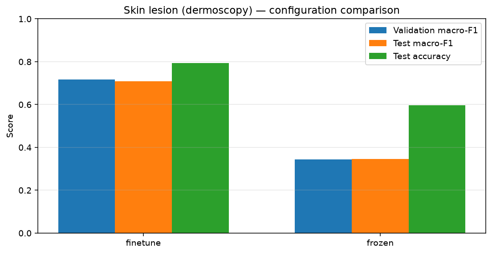

### Brain MRI, selected model

Test set, 1,311 images, weights from epoch 6:

| | Precision | Recall | F1 | Support |
|---|---:|---:|---:|---:|
| Glioma | 99.66% | 98.33% | 98.99% | 300 |
| Meningioma | 97.12% | 99.02% | 98.06% | 306 |
| Pituitary tumor | 100% | 98.67% | 99.33% | 300 |
| No tumor | 99.51% | 100% | 99.75% | 405 |
| **Macro** | **99.07%** | **99.00%** | **99.03%** | 1,311 |
| Weighted | | | 99.09% | |

Accuracy 99.08%. Macro ROC-AUC 99.97%. Twelve images are wrong.

| True | Predicted | Count |
|---|---|---:|
| Glioma | Meningioma | 5 |
| Pituitary tumor | Meningioma | 4 |
| Meningioma | No tumor | 2 |
| Meningioma | Glioma | 1 |

On this test folder the model did not call any of the 405 no-tumor slices a tumor. It did call two meningiomas
“no tumor.” That is a statement about these 1,311 files, not about MRI in general. The mistakes that do happen
are mostly glioma or pituitary read as meningioma: neighboring tumor categories, not a random class.

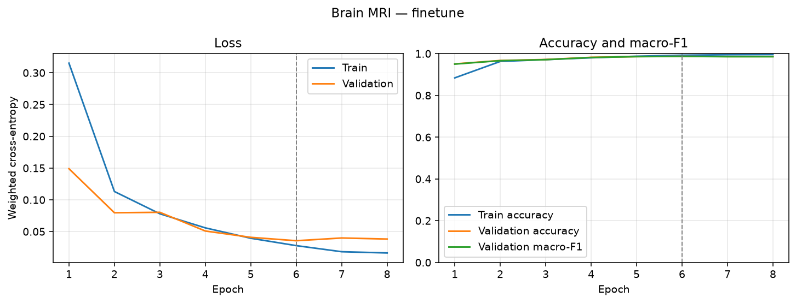

Training loss falls every epoch, from 0.315 to 0.016. Validation loss is lowest at epoch 6 (0.036) and then
ticks up (0.040, 0.038) while validation macro-F1 slips from 0.987 to 0.986. That is mild overfitting, and it
is why the saved weights are epoch 6 rather than the last epoch. Training accuracy in the curves is measured
on augmented batches, so it is a harsher number than a clean pass over the training images.

The frozen model’s validation accuracy was 88.1% and its test accuracy was 82.9%. Validation was cut from the
Training folder, and the official Testing folder is a different mix of the source collections. Fine-tuning
does not show that gap (validation accuracy 98.72%, test 99.08%).

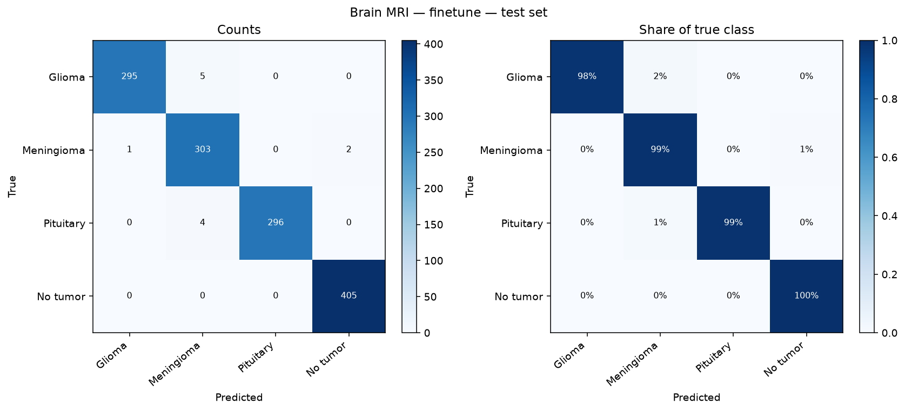

### Skin lesions, selected model

Test set, 2,005 images, weights from epoch 6:

| | Precision | Recall | F1 | Support |
|---|---:|---:|---:|---:|
| Actinic keratoses | 60.9% | 63.6% | 62.2% | 66 |
| Basal cell carcinoma | 68.2% | 85.4% | 75.9% | 103 |
| Benign keratosis | 58.9% | 70.5% | 64.2% | 220 |
| Dermatofibroma | 64.0% | 69.6% | 66.7% | 23 |
| Melanoma | 48.4% | 68.2% | 56.6% | 223 |
| Melanocytic nevi | 95.1% | 83.0% | 88.6% | 1,341 |
| Vascular lesions | 74.3% | 89.7% | 81.3% | 29 |
| **Macro** | **67.12%** | **75.70%** | **70.78%** | 2,005 |
| Weighted F1 | | | 80.52% | |

Accuracy 79.40%. Macro ROC-AUC 96.38%. The AUC says the ranking of classes is much better than the hard
decision at argmax. Weighted F1 (80.5%) looks kinder than macro-F1 because nevi dominate it. I report both and
treat macro-F1 as the result that matters.

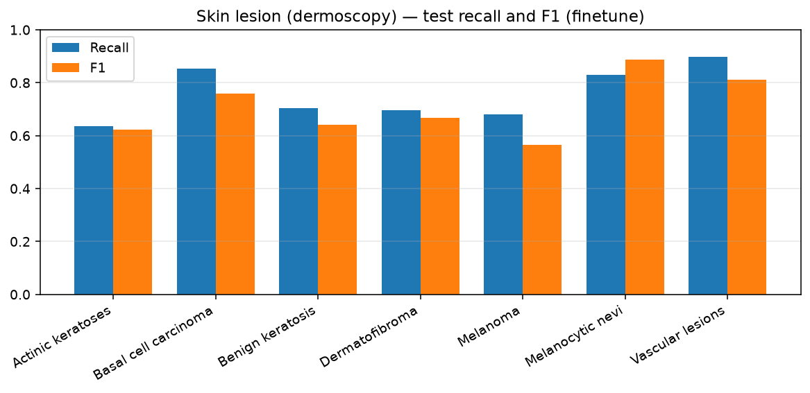

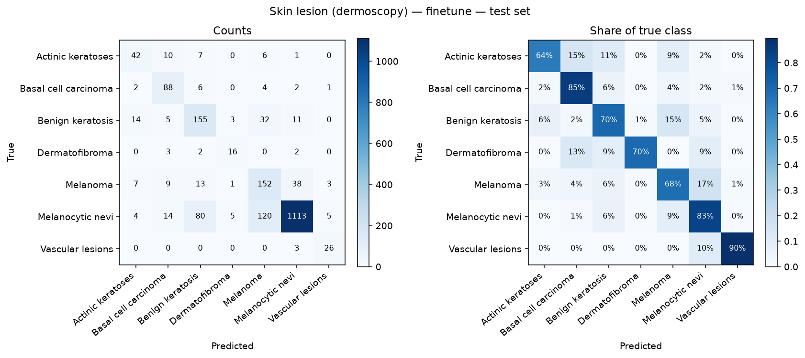

The largest off-diagonal cells, and why they matter:

- 120 nevi predicted as melanoma, and 80 nevi predicted as benign keratosis. Nevus recall is 83%, not because
  the class is hard to recognize in general, but because the weighted loss would rather risk a false melanoma
  than miss a less common class.
- Melanoma precision is 48.4%. When the model says melanoma it is wrong about half the time, mostly on nevi
  (120) and benign keratosis (32). Of 223 true melanomas, 152 are recovered and 38 are called nevi. That pair
  is the failure that accuracy hides. A screening tool that cannot separate these two is not a screening tool,
  and this project does not claim to be one.
- 10 actinic keratoses called basal cell carcinoma. Both are often pink, poorly pigmented lesions in this
  dataset, and the five-case figure below shows the model being 99% sure and still wrong.
- Dermatofibroma and vascular F1 sit on 23 and 29 test images. I would not quote those two numbers as stable.

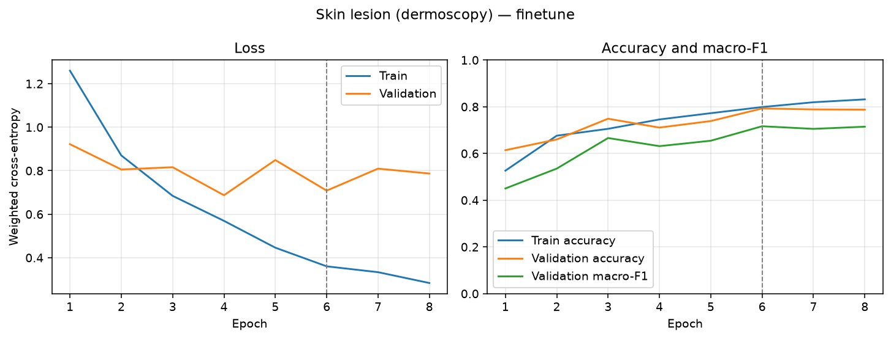

Validation macro-F1 by epoch: 0.450, 0.535, 0.666, 0.631, 0.655, **0.717**, 0.705, 0.715. Training loss falls
the whole way (1.26 down to 0.28). Validation loss is noisy and is higher after epoch 6 than at epoch 6
(0.708, then 0.810 and 0.787). The network is still fitting the training set after the validation score has
stopped improving, so early stopping restores epoch 6. Test macro-F1 (70.78%) is close to the validation score
(71.66%), which is what I want from a split that was not used to pick the epoch.

## Breast microscopy

BreakHis has 7,909 microscope images from 82 patients, at 40×, 100×, 200×, and 400×. I kept every magnification,
and I kept every image from one patient in one split (seed 42): 54 patients in training (4,973 images), 14 in
validation (1,399), and 14 in test (1,537).

| Subtype | In this dataset | Train | Validation | Test |
|---|---|---:|---:|---:|
| Adenosis | benign tissue | 251 | 61 | 132 |
| Fibroadenoma | benign tumor | 557 | 210 | 247 |
| Phyllodes tumor | filed under benign | 60 | 158 | 235 |
| Tubular adenoma | benign tumor | 372 | 132 | 65 |
| Ductal carcinoma | malignant | 2,350 | 518 | 583 |
| Lobular carcinoma | malignant | 429 | 74 | 123 |
| Mucinous carcinoma | malignant | 611 | 119 | 62 |
| Papillary carcinoma | malignant | 343 | 127 | 90 |

Phyllodes tumor is the awkward class. Training saw only 60 images, and the test patient contributed 235.
The subtype model’s test recall on phyllodes is 0. It never predicted that class. Of those 235 slides, 140
were called fibroadenoma. Both are benign tumors, and the slides can look alike, but the subtype is still wrong.
Validation macro-F1 stayed near 0.27 while training loss fell from 1.14 to 0.13, so the network was fitting
the training patients. Test accuracy is 60.31% and test macro-F1 is 54.33%, higher than validation, which is
another way of saying the result depends on which patients were held out.

The benign-versus-malignant model, trained on the same patients, is the result I trust more for this dataset.
Test accuracy 91.80%, macro F1 91.65%, ROC-AUC 96.99%. Validation macro-F1 was 91.68%, almost the same number.
Of 679 benign test slides, 76 were called malignant. Of 858 malignant slides, 50 were called benign.

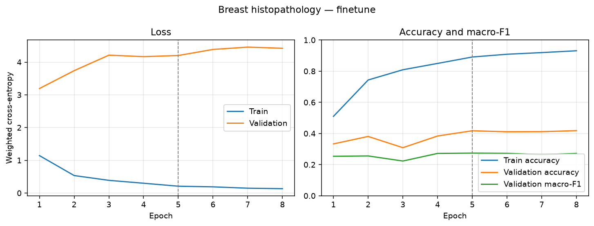

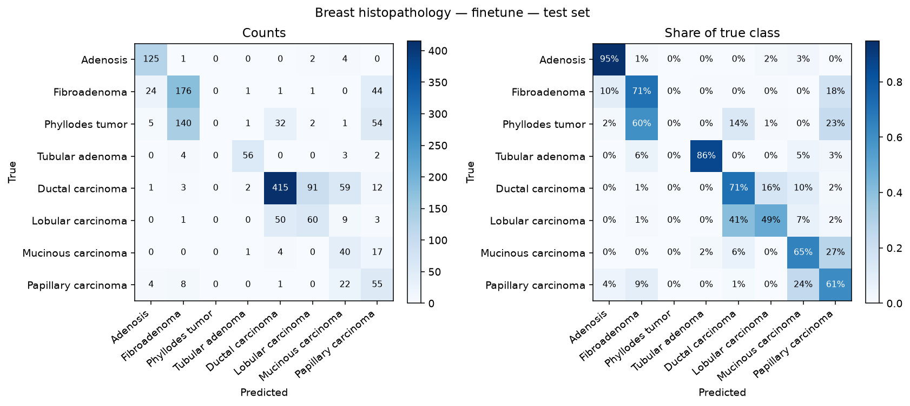

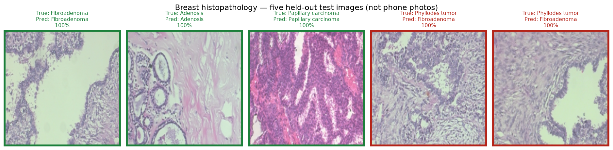

The held-out row includes a fibroadenoma, an adenosis, and a papillary carcinoma at about 100%, and two
phyllodes slides called fibroadenoma at about 100%. A certain score is not evidence the subtype is right.
Those two errors are still on the benign side of the dataset, which is why the coarser model can be right
when the subtype model is wrong.

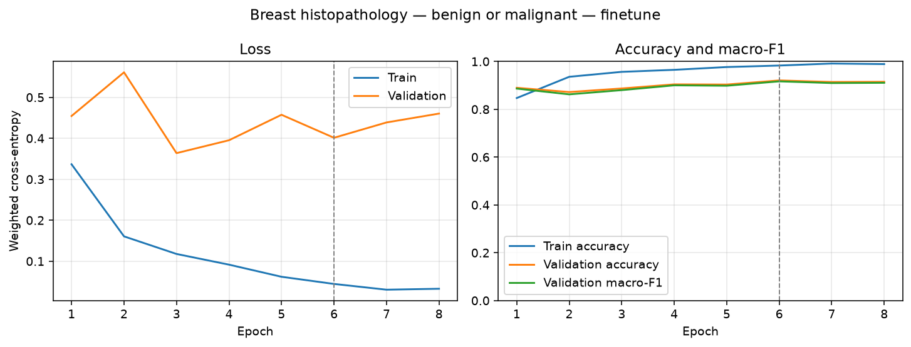

## Lung CT slices

IQ-OTH/NCCD has 1,097 chest CT slices: 416 normal, 120 benign, and 561 malignant, from 110 cases. The public
file names are `Normal case (110).jpg` and `Bengin case (87).jpg` (the dataset spells benign that way). The
number is an image index, not a patient id I could verify, so I split images 70/15/15, seed 42: 767 train,
165 validation, 165 test. Slices from one scan can appear in more than one split. I am not treating 96% or
99% as a patient-level result.

| | Normal (63) | Benign (18) | Malignant (84) |
|---|---:|---:|---:|
| Precision | 95.3% | 84.2% | 100% |
| Recall | 96.8% | 88.9% | 97.6% |
| F1 | 96.1% | 86.5% | 98.8% |

Test accuracy 96.36%, macro F1 93.78%. The benign F1 sits on 18 images. Two normal slices were called benign,
two benign slices were called normal, and no benign or normal test slice was called malignant. One malignant
slice was called normal and one was called benign.

The malignant-or-not model puts normal and benign together. Test accuracy 99.39% (164 / 165). The single error
is a not-malignant slice called malignant. Early stopping restored epoch 3. I do not read this as proof the
model finds cancer. It is a near-separation of these particular files, with a split that can leak scans.

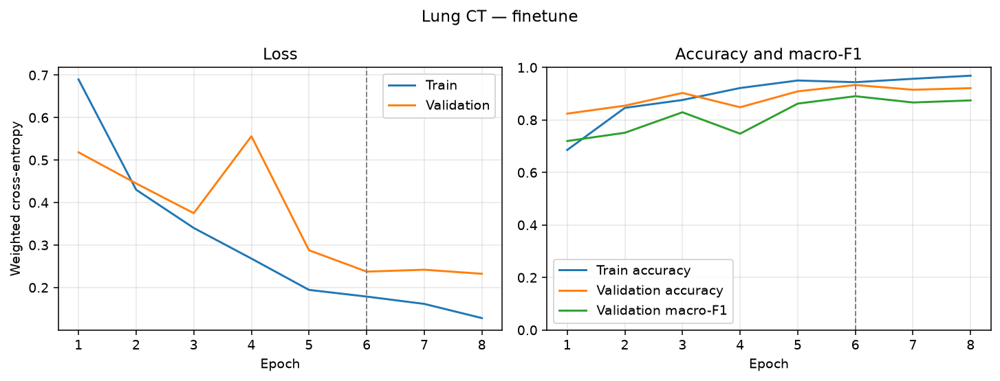

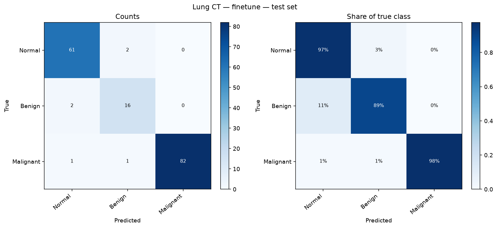

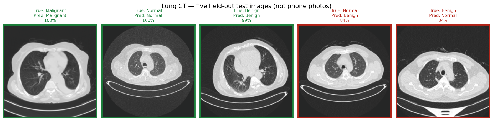

The five held-out slices show a correct malignant, normal, and benign, then a normal slice called benign at
84% and a benign slice called normal at 84%. Those two mistakes stay on the not-malignant side.

## The two questions, side by side

The category model can be turned into a yes-or-no answer by grouping its classes. That is not the same thing
as a model trained on the grouped labels. Both numbers are on the same untouched test images.

| Question | From the category model, classes grouped after prediction | From the model trained on the grouped labels |
|---|---|---|
| Brain: tumor or no tumor | 1,309 / 1,311 correct (99.85%). The only mistakes are 2 meningiomas called no tumor. | 1,307 / 1,311 correct (99.69%). Four mistakes: 2 tumors called no tumor, and 2 no-tumor slices called tumor. |
| Skin: cancer-related or not | 1,741 / 2,005 correct (86.83%). | 1,800 / 2,005 correct (89.78%). Macro F1 84.74%. |

On brain MRI the category model is already the better tumor detector. A second model does not add accuracy.
It is still in the app, because the page is supposed to show both questions, and because its wording is
“tumor,” not “cancer.”

On skin, the model trained on the coarse labels is a bit better at that coarse question. Cancer-related
recall is 82.65% (324 / 392) and precision is 70.28% (324 / 461). So when it says cancer-related it is wrong
about three times in ten, mostly on benign lesions, and it still misses 68 cancer-related images. That is
better than the 7-class model’s melanoma precision of 48%, and it is still not a screening result. The
7-class model remains the one that can say melanoma rather than basal cell carcinoma rather than nevus.

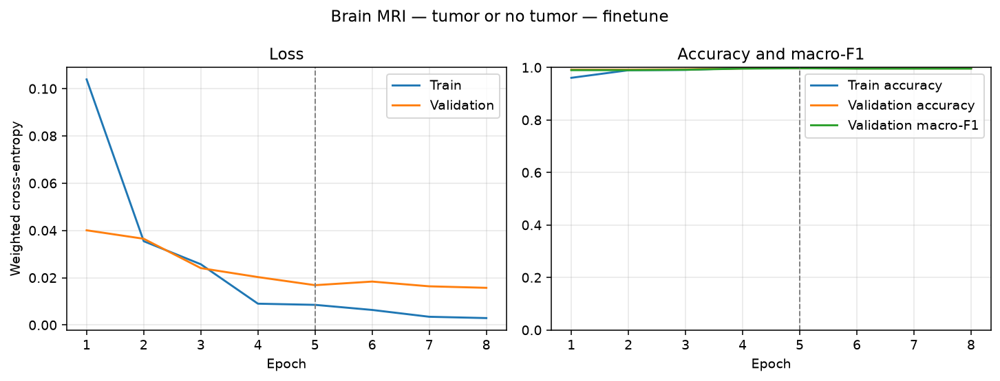

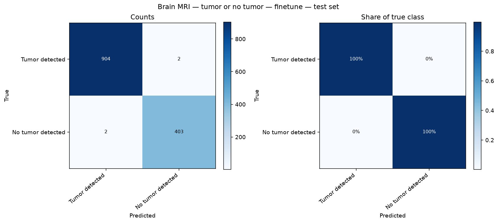

Brain validation macro-F1 peaked at epoch 5 (0.997) and then sat at 0.996 while training loss kept falling.
Epoch 5 is the restored checkpoint. The test confusion matrix is:

|  | Predicted tumor | Predicted no tumor |
|---|---:|---:|
| True tumor | 904 | 2 |
| True no tumor | 2 | 403 |

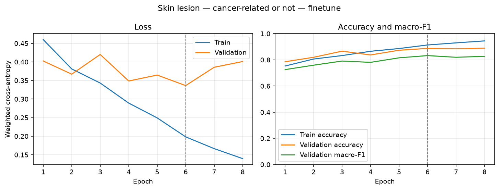

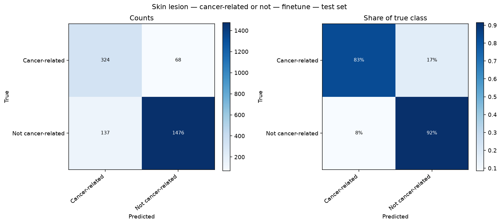

Skin validation macro-F1 peaked at epoch 6 (0.833). Validation loss was 0.336 there and 0.401 by epoch 8,
so the later epochs were fitting the training set. The restored epoch-6 confusion matrix is:

|  | Predicted cancer-related | Predicted not cancer-related |
|---|---:|---:|
| True cancer-related | 324 | 68 |
| True not cancer-related | 137 | 1,476 |

## Five held-out cases

These five-plus-five images are taken from the test splits after training. They are not phone photos. Each
pair of figures shows the image with the true class and the prediction, then the Grad-CAM for the same files.
Correct cases are high-scoring examples; the last two of each row are high-scoring mistakes, so the figure is
not a sample of typical errors only. Brain has 12 errors in 1,311. Skin is wrong much more often than these
two frames suggest.

### Brain MRI

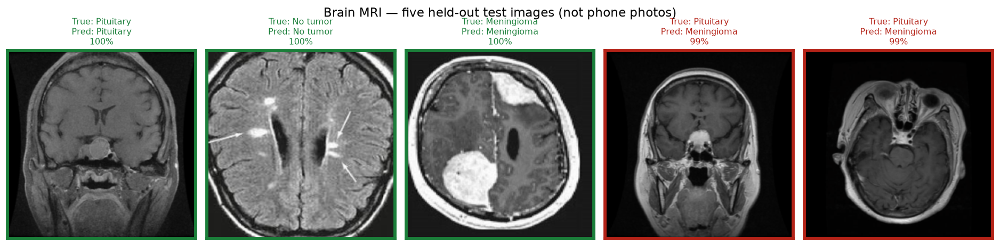

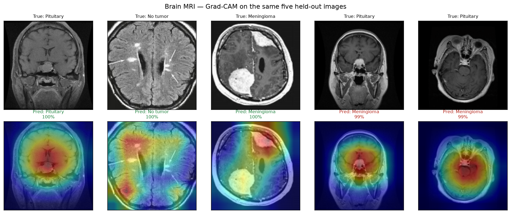

| True | Predicted | Score |
|---|---|---:|
| Pituitary tumor | Pituitary tumor | 100.0% |
| No tumor | No tumor | 100.0% |
| Meningioma | Meningioma | 100.0% |
| Pituitary tumor | Meningioma | 99.1% |
| Pituitary tumor | Meningioma | 99.1% |

The three correct slices are easy for this model: a bright focus near the skull base called pituitary, an axial
slice with no mass called no tumor, and a large bright extra-axial mass called meningioma. On the correct
meningioma the heatmap sits on that bright mass. On the no-tumor slice it is spread across bright vessels and
cortex, so the color is not an outline of a finding. The two errors are the same confusion the matrix already
shows, pituitary read as meningioma, and the score is still about 99%. The heat sits centrally, where a
pituitary lesion would also sit. A confident score and a tidy heatmap can both be wrong.

### Skin

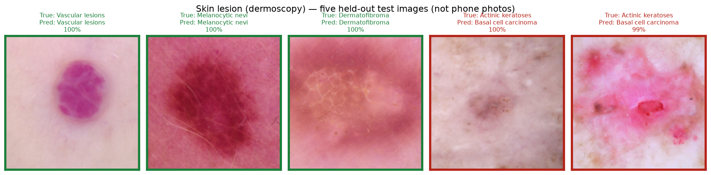

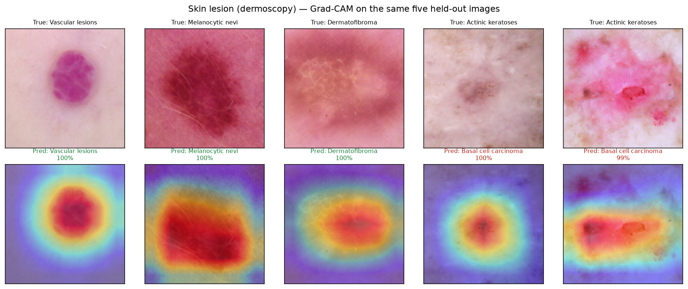

| True | Predicted | Score |
|---|---|---:|
| Vascular lesion | Vascular lesion | 100.0% |
| Melanocytic nevus | Melanocytic nevus | 100.0% |
| Dermatofibroma | Dermatofibroma | 100.0% |
| Actinic keratoses | Basal cell carcinoma | 99.9% |
| Actinic keratoses | Basal cell carcinoma | 99.2% |

The three correct lesions are visually distinct in this set: a purple vascular lesion, a brown nevus, and a
pale dermatofibroma. The heatmap sits on the lesion in those three and also on the two mistakes. The mistakes
are actinic keratoses called basal cell carcinoma at 99%. Those two categories can look similar here (pink,
scaly, little pigment), which matches the 10 akiec→bcc cells in the test matrix. The heatmap does not know
that the label is wrong. I am describing what the pictures look like, not making a clinical claim.

## Deployment

`app.py` is a Gradio page named Two Answers, on `http://127.0.0.1:7860`. The user picks Brain MRI, Breast histopathology, Skin lesion, or Lung CT, uploads an
image, and presses Run model. The page returns both answers: the specific category, with a sentence that says
whether that category is a tumor, a malignant lesion, a precancerous lesion, or a benign lesion in the
dataset; then the yes-or-no model’s answer and whether the two models agree. It also shows both score charts
and a Grad-CAM image from the category model. The disclaimer at the top says a tumor is not cancer. If a top
score is under 70%, or the next score is within 15 points, the text says that model is not sure. Example rows
are held-out public images, one per category, so the page can be tried before any personal photo is added.

## Phone photos

The assignment asks for five photos taken with my own phone, passed through the model, shown next to the real
class, and discussed. I have not taken those photos yet, and I did not download stand-in pictures. A photo of
a monitor is not an MRI, and an ordinary phone close-up is not a dermoscope, so those five images will be a
stress test of the app rather than another test-set score. The pipeline is ready:

1. Put the files in `phone_photos/brain/`, `breast/`, `skin/`, or `lung/`. iPhone HEIC is accepted.
2. Optionally fill `phone_photos/labels.csv` with `filename,true_label`. The label has to match a class name
   (for example `No tumor` or `melanoma`).
3. Run `python predict_photos.py`. It writes `results/phone_brain.md`, `results/phone_skin.md`, and a contact
   sheet for each task.

The five held-out cases in the previous section are the labeled public comparison. They do not replace the
phone photos. If the course accepts five held-out public images instead, the figures above are that comparison.

## What I would not claim

- The app does not detect cancer. The brain yes-or-no model detects a tumor category. The skin yes-or-no
  model detects a cancer-related HAM10000 label, including a precancerous one.
- Calling a meningioma or a pituitary tumor “cancer” would be wrong for this dataset. The page is written so
  it cannot do that.
- 99% on the brain test folder is real for that folder. It is not a measurement of performance on a new
  hospital, because patient identity is not in the files and the pictures are already cropped and clean.
- 79% skin accuracy beats the 67% nevus baseline and still leaves melanoma precision at 48%. The coarser
  skin model reaches 89.8% accuracy with 70% precision on the cancer-related group. That is the better number
  for the coarse question, and it is still not a number I would use for a health decision.
- Grad-CAM is a visualization of the last convolutional block. On these examples it often covers the lesion
  whether the class is right or wrong.
- BreakHis subtype accuracy is 60% on a patient split, and phyllodes recall is 0. The 92% benign-versus-malignant
  number is the one that matches the labels the dataset actually supports across patients.
- The lung scores use an image split. They are not a patient-level result, and they are not nodule detection.
- LIDC-IDRI is not in this project.
